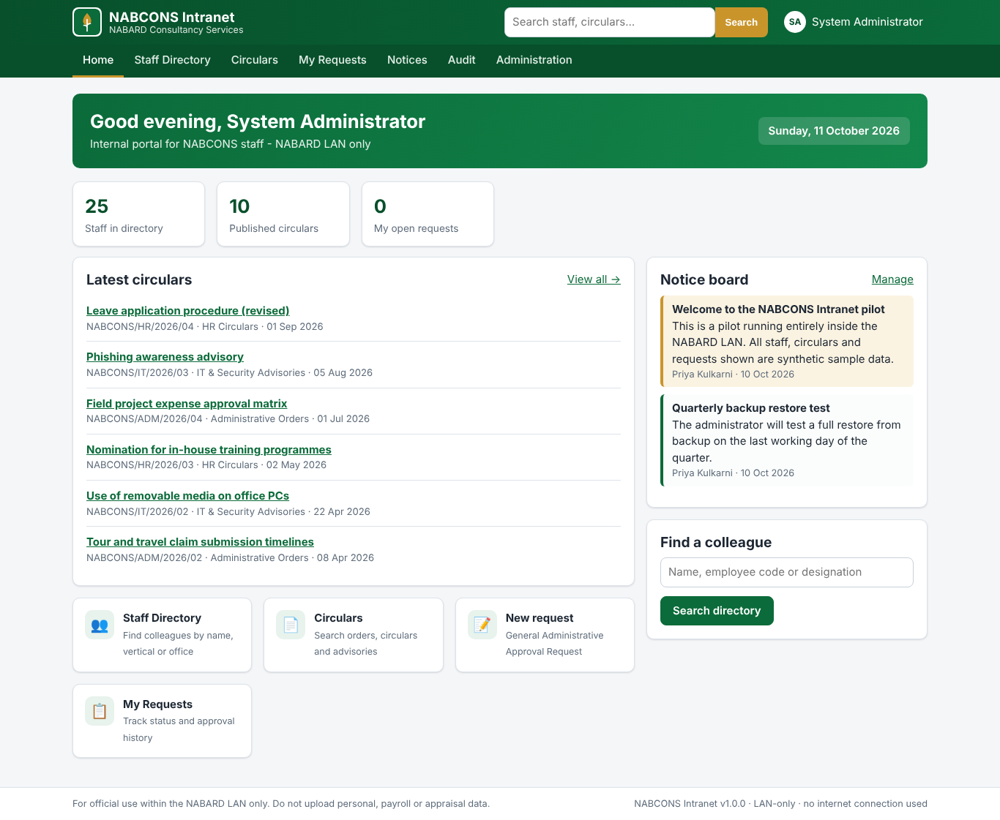
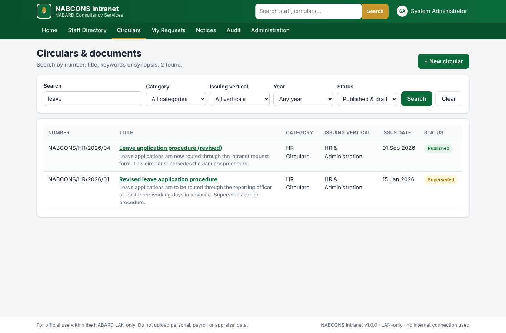
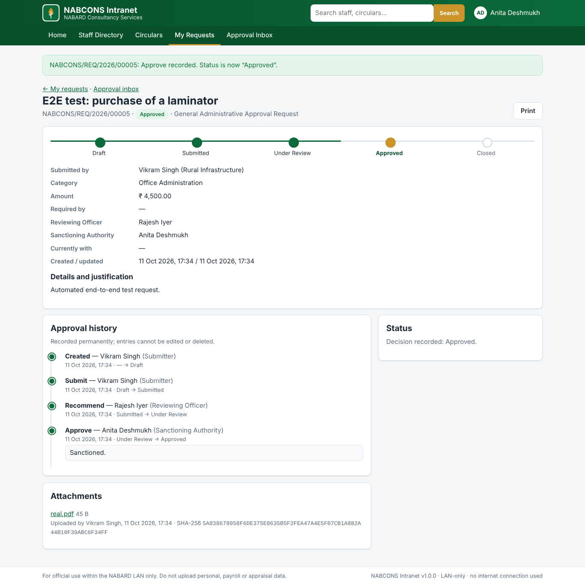

# NABCONS Intranet

A ready-to-run intranet for **NABARD Consultancy Services (NABCONS)**, built for an **isolated NABARD LAN**. You download one ZIP, copy it to an office PC and double-click to start. The office PC needs no installation, no internet connection and no coding.

## Download and run (no coding)

1. **Download** [`release/NABCONS-Intranet-v1.3.0-win-x64.zip`](release/NABCONS-Intranet-v1.3.0-win-x64.zip) (≈ 53 MB). On GitHub, open the file and click **Download raw file**.
   SHA-256: see [`release/NABCONS-Intranet-v1.3.0-win-x64.zip.sha256`](release/NABCONS-Intranet-v1.3.0-win-x64.zip.sha256).
2. **Transfer** it to the office PC by the IT-approved method. Right-click → *Properties* → *Unblock*, then **extract** it to `C:\NABCONSIntranet\`.
3. **Double-click `Start-Intranet.bat`.** Keep the black window open. It shows the address to use.
4. **Open** `http://localhost:8080` on that PC, or `http://<PC-name>:8080` from colleagues' PCs. If they cannot connect, right-click `Open-Firewall-Port.bat` → *Run as administrator*.
5. **Sign in** with a demo account. The password for all of them is `Nabcons@2026`:

   | User | Role in the demo |
   |---|---|
   | `admin` | Administrator — users, roles, staff directory, masters, backups |
   | `publisher` | Publisher — circulars and notice board |
   | `approver1` | Approver — Reviewing Officer (level 1) |
   | `approver2` | Approver — Sanctioning Authority (level 2) |
   | `staff` | Ordinary staff member |
   | `auditor` | Read-only audit reviewer |

To keep it running permanently in the background, starting with Windows, right-click `Install-As-Windows-Service.bat` → *Run as administrator*.

When the pilot is accepted, follow **Going live** in the [Administrator Guide](docs/ADMIN-GUIDE.md) to remove the synthetic demo data and demo accounts.

## What it does (the MVP scope from the design note)

| Module | Highlights |
|---|---|
| **Home page** | Branded landing page, notice board, latest circulars, pending-approval count, quick links |
| **Staff directory** | Search by name, code, designation, e-mail, extension; filter by vertical and office; controlled CSV import with preview; mobile numbers shown only where disclosure is approved |
| **Circulars & documents** | Metadata + keyword/synopsis full-text search (SQLite FTS5); categories; *All staff / Vertical only / Restricted* visibility; drafts, publishing, versions with SHA-256, supersession and withdrawal |
| **Approval workflow** | *General Administrative Approval Request*: Draft → Submitted → Under Review → Approved / Returned / Rejected → Closed; two levels (Reviewing Officer, Sanctioning Authority); attachments; inbox; permanent history; protection against two people acting at once |
| **Roles** | Staff, Publisher, Approver, Administrator, Auditor |
| **Audit log** | Append-only, hash-chained (tamper-evident), searchable, CSV export, one-click integrity check |
| **Backup & restore** | Automatic daily ZIP backup with checksum, retention, optional copy to a LAN share, checksum-verified restore |
| **e-Note** (v1.3) | Digital note-sheet: draft, then mark to any colleague following the office hierarchy; comments, attachments, send back, return to initiator, approve or reject; numbered text versions; append-only note-sheet; approved notes visible to all staff (unless confidential); archival PDF in English and Hindi; register with ageing for Administrators and Auditors (metadata only) |
| **My Desk & notifications** (v1.3) | One page with everything waiting for you; in-app bell with live badges (a small poll, no WebSockets) |
| **Self-registration** | Staff register with their 10-digit mobile number (details pre-filled from the directory, masked); an administrator approves, which creates the account and fills in the staff directory |
| **My Profile** | Staff keep their own mobile, extension, e-mail and office up to date; vertical changes approved by the administrator; every change audited |
| **Photos & contact cards** | Staff photos (metadata removed); click a name in the directory for a card with call/e-mail/copy and *Save contact* (.vcf) |
| **Business Leads** | Anyone submits opportunities (`NCS/BD/<FY>/0001`); BDU, COO and MD work the pipeline, dashboard and Excel export; append-only timeline |
| **Sign-in** | Local accounts (salted PBKDF2 hashes, lockout, password policy) **or** Windows Authentication / Active Directory with AD-group role mapping |

| Circulars | Approval with full history |
|---|---|
|  |  |

**No runtime internet dependency:** no CDN, cloud API, AI service, licence server, telemetry, update check, Docker, package manager or Microsoft 365. All styles, scripts and icons are bundled locally.

## Documents

| Document | For |
|---|---|
| [`README-FIRST.txt`](deploy/windows/README-FIRST.txt) | One-page quick start (also inside the ZIP) |
| [Deployment Guide](docs/DEPLOYMENT-GUIDE.md) | Office PC, Windows service, firewall, HTTPS, Windows Authentication, IIS |
| [Setup Guide 1.2](SETUP_GUIDE.md) | Upgrading to 1.2.0: `--migrate`, new settings, LeadViewer role for COO/MD, BDU vertical, linking accounts, where photos are stored |
| [Testing checklist 1.2](TESTING_CHECKLIST.md) | Manual test script for the office machine |
| [Changelog](CHANGELOG.md) | What changed in each version |
| [Upgrade Guide](docs/UPGRADE-GUIDE.md) | Installing a new version over a live intranet **without losing any data**, and rolling back |
| [Administrator Guide](docs/ADMIN-GUIDE.md) | Going live, users and roles, CSV import, circulars, workflow, audit, backup and restore |
| [IT & Security Note](docs/IT-SECURITY-NOTE.md) | One-page architecture note and validation checklist for NABARD IT clearance |
| [Test Script](docs/TEST-SCRIPT.md) | Structured acceptance and security tests |
| [Software Bill of Materials](docs/SBOM.md) | Pinned components and licences |

## For developers

- Source: `src/NabconsIntranet` — ASP.NET Core 10 Razor Pages, SQLite through Microsoft.Data.Sqlite, no front-end frameworks.
- Run locally: `dotnet run --project src/NabconsIntranet` (needs the .NET 10 SDK), then open http://localhost:8080.
- Build the Windows package: `bash build/package.sh` → `release/*.zip`. GitHub Actions (`.github/workflows/build-release.yml`) builds it on every push. Pushing a tag `v*` attaches it to a GitHub Release.
- Use synthetic data only on development machines.
